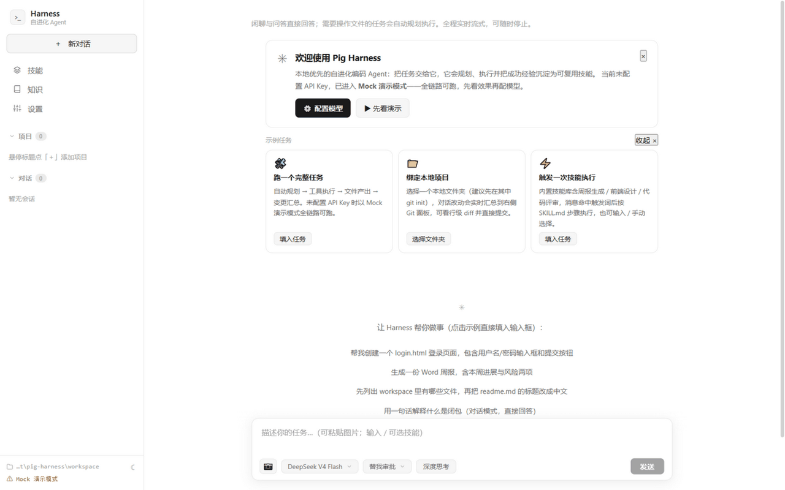
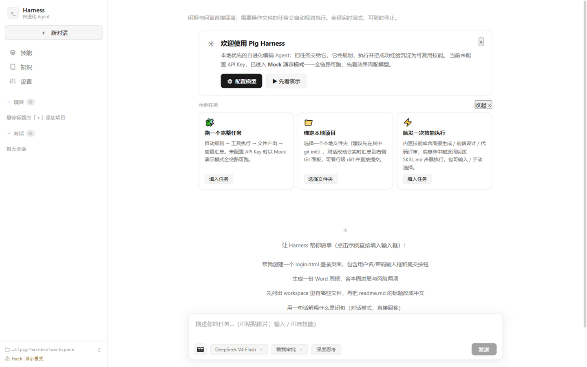

# Pig Harness — A Local-First, Self-Evolving Coding Agent

**Hand it a task; it plans, executes, and delivers — then distills what worked into reusable skills. Your code and data never leave your machine.**

[中文文档](./README.md) ｜ [Full project docs (AGENTS.md)](./AGENTS.md)



More than a chatbot: give it a task and it **plans steps → calls tools (file ops / shell commands) → delivers artifacts**, fully streamed and visualized. In project mode, every change shows up live in the Git panel (line-level diff, one-click commit). After a few successful runs of similar tasks, it **synthesizes a skill draft and validates it in an isolated sandbox** — the same kind of task gets reused next time. It gets smarter the more you use it.

## Up and running in 30 seconds (no API key required)

```bash
git clone https://gitee.com/<you>/pig-harness.git
cd pig-harness
./run.sh        # Windows: run.bat (just double-click)
```

The launcher checks for JDK 21+, builds with Maven if the jar is missing, then opens `http://localhost:8080` in your browser.

**No API key? No problem.** Without a key the app runs in **Mock demo mode** — planning, tool calls, file artifacts, report export, and skill synthesis all work end to end (conclusions are demo text). Explore first, configure later. The welcome card on first launch offers a one-click demo:



**Or use Docker:**

```bash
docker compose up -d          # data persists in a named volume
# with your own key:
HARNESS_LLM_API_KEY=sk-xxx docker compose up -d
```

To go live, add a model profile in **Settings → Models** (any OpenAI-compatible endpoint: DeepSeek, Qwen, OpenAI, local vLLM…), or set `HARNESS_LLM_API_KEY` / `HARNESS_LLM_BASE_URL`.

## How it differs from Cursor / Cline / Claude Code

| Dimension | Pig Harness | Cursor / Cline (IDE agents) | Claude Code | OpenHands |
|-----------|-------------|------------------------------|-------------|-----------|
| Deployment | **Single local jar / Docker**, browser UI, no IDE needed | IDE plugin / desktop app | CLI / IDE plugin | Self-hosted web (heavier) |
| Model binding | **Any OpenAI-compatible endpoint**, multi-profile + deep-thinking toggle + light-model routing | Built-in first | Anthropic only | Multi-model |
| Skill self-evolution | ✅ **Successful tasks auto-cluster → synthesize skill draft → sandbox validation → usage stats** (plus manual "save as skill" / SKILL.md import) | ❌ | Skills ecosystem (hand-written) | ❌ |
| Approvals & permissions | Four tiers: auto / ask (per-write approval cards) / full access / **plan mode (read-only research + clarifying questions + plan doc)** | Confirmation popups | Permission modes | Container sandbox |
| Multi-agent | ✅ Plan-time DAG decomposition + virtual-thread fan-out + git worktree isolation + spawnAgent subagents | ❌ | Subagents | ✅ |
| MCP | ✅ Streamable HTTP (JSON/SSE), external tools require approval by default | ✅ | ✅ | ✅ |
| Git integration | Project binding + live change panel + line-level diff + commit/push | ✅ (in IDE) | ✅ | ✅ |
| Data ownership | **All local**: single-file SQLite + `skills/` + `workspace/` | Mostly local | Cloud sessions | Local |

> Comparison based on publicly available capabilities (Sept 2026); consult official docs for details. Pig Harness differentiates on the **self-evolution loop** and **zero-dependency local deployment**.

## Highlights

- **Multi-model + deep thinking**: built-in and custom profiles side by side; switch to a reasoning model on demand; light-model routing sends chit-chat to cheaper models.
- **Four permission tiers**: auto (default, sandboxed to the work root), ask (approval card per write), full access, and plan mode (read-only research, asks you questions, produces a plan document).
- **Execution report export**: download any turn as a Markdown report (plan ✓✕ / tool-call table / produced files / change ±lines / token usage).
- **Verification hooks**: define verify commands (e.g. `mvn -q compile`) in `.harness/hooks.json`; they run before delivery and failures are fed back for self-repair.
- **Image understanding**: paste screenshots with Ctrl+V; a vision model describes them and the agent acts accordingly.
- **Context management**: live context-usage badge plus two-tier auto-compaction (conversation-level LLM summary + task-level tool-output placeholders).
- **Knowledge memory**: preferences and project facts are extracted after tasks and injected into future ones.


| | |
|---|---|
|  |  |

Looking for a playground? Bind [samples/demo-app](./samples/demo-app) (a minimal todo page) as a project — `git init` first and you'll see line-level diffs on every change.

## Privacy & data ownership

- **Code is only sent to the LLM endpoint you configure** (you set `base-url` — DeepSeek, Qwen, OpenAI, or a LAN vLLM/Ollama).
- Everything else stays local: single-file SQLite (`db/harness.db`), skill library (`skills/`), sandbox workspace (`workspace/`). Delete the directories and the data is gone.
- No sign-up, no telemetry, no phone-home. In Docker, all data lives in the `/data` volume.
- Known boundary: when using a cloud LLM, task content (including code snippets) is subject to that provider's privacy policy — use a local model endpoint if that matters to you.

## Docs

Full architecture, SSE event protocol, API reference, and 26 engineering pitfalls: [AGENTS.md](./AGENTS.md). Planning documents live in [docs/plan/](./docs/plan/).

Core capabilities: task planning (Planner + plan mode) ｜ main execution loop (30-step cap + wrap-up summary) ｜ file tools (write/edit/delete/read/list/grep) ｜ shell execution (deny-list + optional Docker isolation) ｜ code semantic index (codeSearch, needs an embedding key) ｜ multi-agent fan-out ｜ subagents ｜ skill library (system + personal + auto-synthesis) ｜ MCP ｜ vision ｜ knowledge memory ｜ execution reports ｜ dark & light themes

## FAQ

**"Java 21+ required" on startup?**
Spring Boot 3.4 + virtual threads need JDK 21 or newer. [Download Temurin JDK 21](https://adoptium.net/temurin/releases/?version=21) and verify with `java -version`; if still not found, set `JAVA_HOME` and add its `bin` to PATH.

**First build is slow / fails?**
Maven downloads dependencies on first run (1–3 minutes). You can also grab `harness.jar` from the Releases page, drop it into `harness/target/`, and run `run.bat` / `run.sh`.

**Do shell commands work on Windows?**
Yes — it prefers the bash bundled with Git for Windows and falls back to `cmd /c` otherwise. Dangerous commands (`rm -rf /`, `format`, …) are blocked by a built-in deny list.

**Port 8080 taken?**
`java -jar harness/target/harness.jar --server.port=8081`.

**Corporate proxy / self-hosted models?**
Add a profile in Settings → Models with your OpenAI-compatible endpoint. For JVM-level proxies: `java -Dhttps.proxyHost=... -Dhttps.proxyPort=... -jar ...`.

**Do git CRLF warnings break anything?**
No. Git output parsing separates stdout/stderr, and the file-edit tool adapts to CRLF/LF line endings automatically.

## Contributing

Issues and PRs welcome. Development build:

```bash
cd frontend && npm install && npm run build   # frontend is embedded into the backend
mvn -f harness/pom.xml -DskipTests package    # output: harness/target/harness.jar
```

## License

[MIT](./LICENSE)
