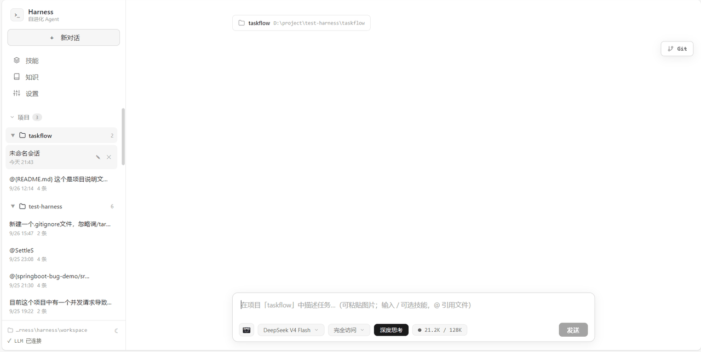
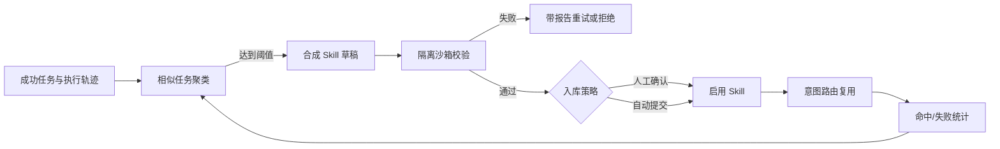
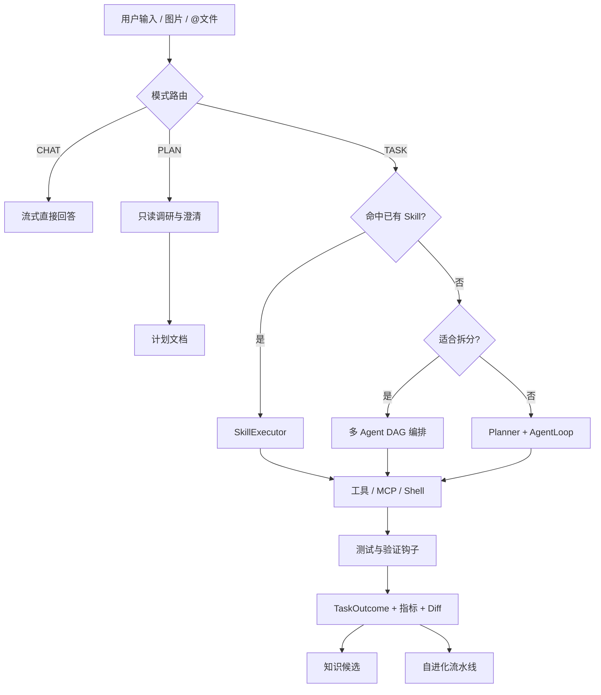
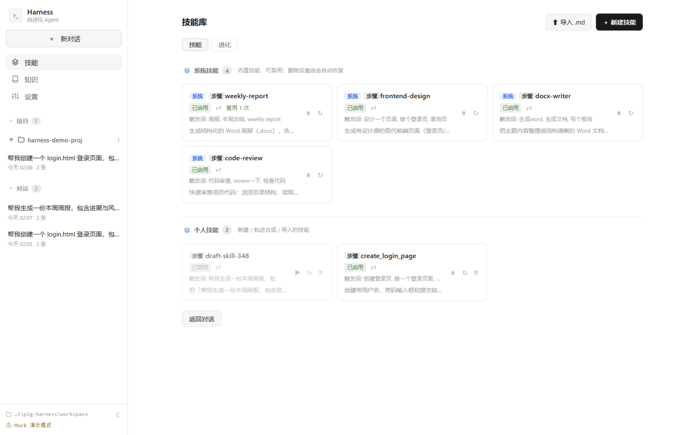
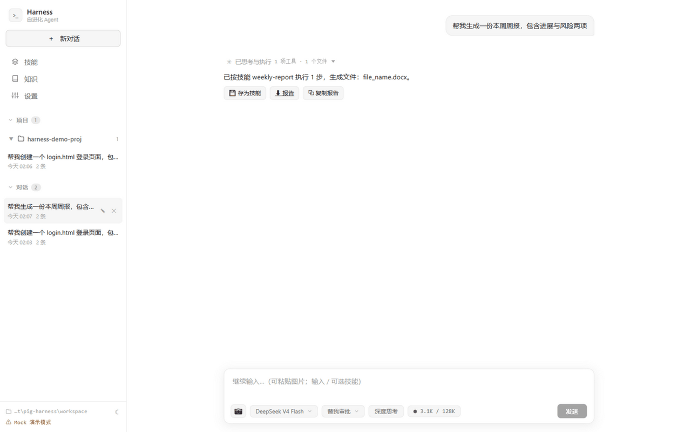
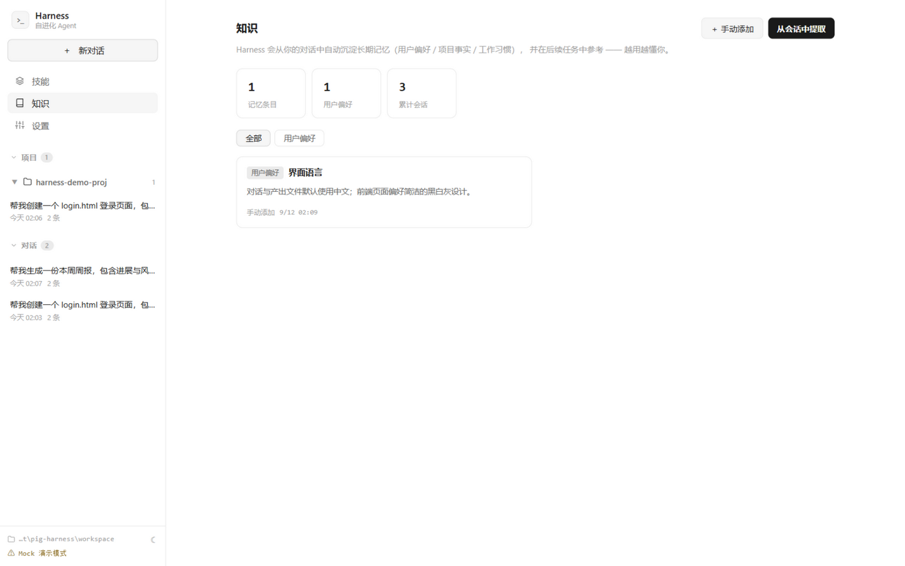
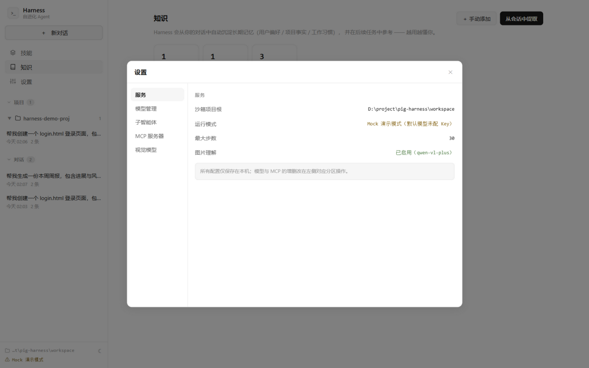
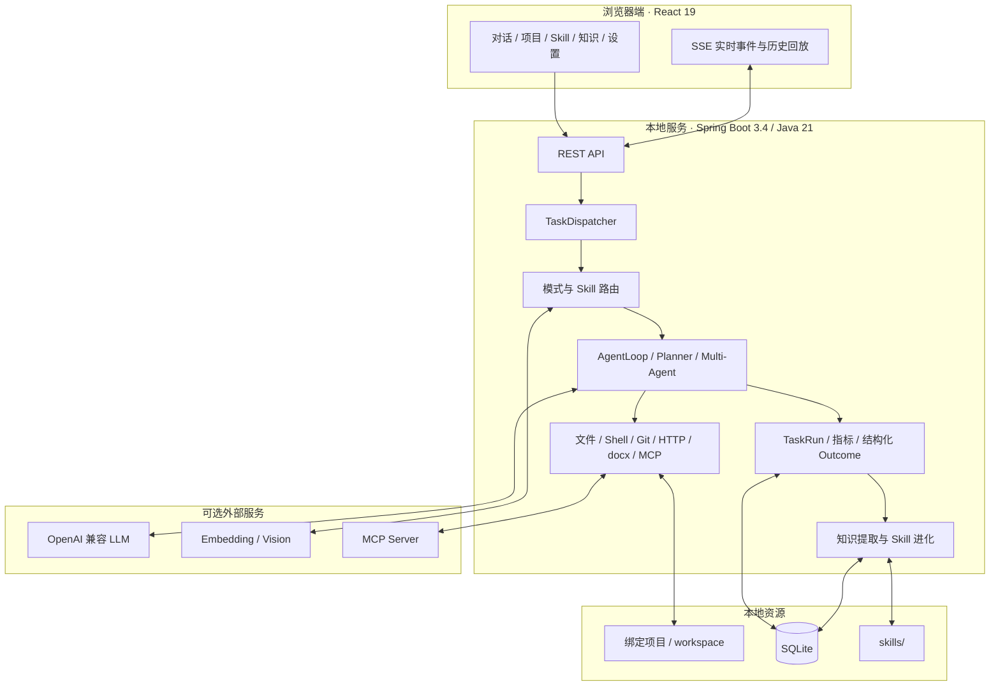

# Pig Harness

> 本地优先的自进化编码 Agent：规划并执行任务，把成功经验沉淀为可复用技能。

[](https://adoptium.net/temurin/releases/?version=21)
[](https://spring.io/projects/spring-boot)
[](https://react.dev/)
[](https://www.sqlite.org/)
[](./LICENSE)

[English](./README.en.md) · [项目总纲](./AGENTS.md)



Pig Harness 是一个运行在本机的 Web Coding Agent。你可以像聊天一样描述需求，它会理解当前项目、拆解任务、读写文件、执行命令、验证结果，并把完整过程实时展示出来。

它和普通聊天助手最大的区别是：**不仅给建议，还会在明确的权限边界内完成交付；不仅记录历史，还会把反复成功的方法沉淀成可复用 Skill。**

应用、会话、项目绑定、执行轨迹、知识和技能默认保存在本机；如果使用云端模型，只有完成任务所需的上下文会发送到你配置的模型服务商。也可以接入局域网内的 OpenAI 兼容模型，让模型调用也留在自己的环境中。

## 目录

- [它能帮你做什么](#它能帮你做什么)
- [核心能力](#核心能力)
- [工作原理](#工作原理)
- [界面预览](#界面预览)
- [快速开始](#快速开始)
- [模型与外部能力配置](#模型与外部能力配置)
- [权限、安全与数据边界](#权限安全与数据边界)
- [项目级验证钩子](#项目级验证钩子)
- [技术架构](#技术架构)
- [项目结构](#项目结构)
- [开发与测试](#开发与测试)
- [API 概览](#api-概览)
- [常见问题](#常见问题)
- [路线图与项目状态](#路线图与项目状态)
- [参与贡献](#参与贡献)

## 它能帮你做什么

### 对个人开发者

- 用自然语言完成 Bug 修复、功能开发、重构、测试补充、文档编写和交付检查。
- 把任意本地目录绑定为项目，直接查看本轮修改、逐文件 diff、增删行数和 Git 状态。
- 在浏览器里获得接近 IDE Agent 的执行体验，不依赖特定编辑器。
- 将常用流程保存为 Skill，例如“新增 Spring Boot CRUD 模块”“发版前质量检查”“生成周报”。
- 用计划模式先调研和讨论方案，确认后再让 Agent 动手。

### 对团队和技术负责人

- 把团队规范、检查步骤和交付流程固化为可版本化的 `SKILL.md`。
- 通过审批卡、沙箱根、危险命令拦截和验证钩子控制自动化边界。
- 通过 TaskRun、Token、调用次数、耗时、验证结果和文件变更回看一次任务为何成功或失败。
- 接入内部 OpenAI 兼容模型、MCP 服务和私有工具，不把执行框架绑定在某一家模型厂商上。

### 典型任务

| 场景 | 可以这样说 | Pig Harness 会做什么 |
|---|---|---|
| 修复缺陷 | “定位搜索结果偶尔回退的问题，补测试并修复” | 检索代码、分析调用链、最小修改、执行测试、汇总证据 |
| 开发功能 | “给任务管理项目增加标签和筛选” | 规划前后端改动、编辑文件、构建验证、展示 diff |
| 仓库理解 | “解释这个项目的鉴权链路和扩展点” | 读取文件、grep/语义检索、形成结构化说明 |
| 安全规划 | “只分析 SQLite 迁移 PostgreSQL 的方案，不要改文件” | 进入只读计划模式、提出必要问题、输出实施计划 |
| 质量检查 | “运行编译、测试和前端构建，失败就修复” | 调用 shell/项目 Hook、回灌错误、迭代修复 |
| 内容交付 | “根据数据生成周报和 docx” | 复用技能、生成 Markdown/Word 文件、提供预览 |
| 重复流程 | “以后都按这套步骤发布” | 保存或自动合成 Skill，后续意图命中并复用 |

## 核心能力

### 1. 从需求到可验证交付

- **CHAT / TASK 智能分流**：普通问答直接流式回答；需要动手的任务进入规划执行链路。
- **Plan → Act → Observe → Reflect**：先理解目标，再调用工具，根据真实结果继续推进。
- **真实工具执行**：支持文件读取、创建、精确编辑、删除、目录遍历、grep、代码语义检索、HTTP 请求、docx 生成和 shell 命令。
- **交付前验证**：代码工程发生修改后，优先执行编译、测试、Lint 或项目自定义 Hook，不把“看起来完成”当成完成。
- **结构化结果**：每轮请求持久化为 TaskRun，保存状态、耗时、Token、模型/工具调用、验证证据和文件变更。
- **可恢复执行**：切换页面不会终止任务，可重新进入会话续看实时输出；也可主动停止。

### 2. 面向真实仓库的项目模式

- 通过文件夹选择器绑定本地项目，后续会话自动使用该目录作为工作根。
- 右侧 Git 面板展示分支、ahead/behind、文件状态、增删行和逐行 diff。
- 支持在界面内提交与推送；未跟踪文件也能统计行数并生成新增 diff。
- 输入 `@` 引用项目文件，Agent 会按消息中的位置读取相应内容。
- 文件产物可在右侧挤压式抽屉中预览，支持代码、Markdown、HTML、图片和 docx 下载。
- 可选 Git worktree 隔离多 Agent 子任务，降低并行修改互相污染的风险。

### 3. 多 Agent 与子智能体

- 复杂任务可拆成子任务 DAG，使用 Java 虚拟线程按依赖波次并行执行。
- 子 Agent 拥有独立工作记忆，并继承模型、权限、沙箱和审批规则。
- 共享黑板用于登记结果与文件占用，冲突或失败会被隔离并汇总给主 Agent。
- 内置“代码探索”角色，也可以创建自己的子智能体档案。
- 前端按泳道展示各个 Agent 的状态、工具调用和局部结论。

> 多 Agent 总开关默认开启；计划期自动拆分默认关闭，可按需要启用。Agent 仍可在单个复杂任务中按需调用子智能体。

### 4. 自进化 Skill 闭环

- 内置系统 Skill，也支持导入、编辑和显式 `/` 提及个人 Skill。
- Skill 支持步骤式和提示词式两种形态，可兼容社区风格的 `SKILL.md`。
- 任务成功后异步聚类；同类成功任务达到阈值时，自动合成一个 Skill 草稿。
- 草稿会在隔离沙箱中检查执行、产物、结构、安全和路径泛化，失败可带报告重试。
- 默认由用户确认后入库；也可配置自动提交。
- 记录命中次数、失败次数、最近使用时间、复用率和节省估算。



### 5. 上下文、知识与长期使用

- 显示当前会话上下文容量和累计 Token/成本。
- 接近模型窗口时进行两级压缩：对话摘要 + 旧工具输出占位，尽量保留最近工作现场。
- 从最新用户输入中提取有原文证据的知识候选，**审核后**才会进入长期记忆。
- 知识支持项目级作用域，相关任务只注入少量匹配内容，减少无关上下文污染。
- 会话、消息、运行轨迹、技能、知识、模型档案和指标统一存入本地 SQLite。

### 6. 模型和外部能力不锁定

- 支持任意 OpenAI 兼容 Chat Completions 端点，例如 DeepSeek、通义、OpenAI、vLLM 等。
- 多模型档案可以在界面切换，支持普通模型、推理模型和轻模型路由。
- 视觉模型可理解粘贴、拖拽或选择的图片，再把描述交给任务执行链路。
- Embedding 可用于 Skill 路由和代码语义索引；未配置时 Skill 检索降级为关键词匹配。
- MCP Host 同时支持 Streamable HTTP 和 stdio，本地或远端工具都能动态注册。
- `httpFetch` 默认拦截环回、私网、ULA、CGNAT 等地址，降低 SSRF 风险。

### 7. 为“可观察”而设计的界面

- LLM 内容、推理说明、计划进度和工具状态通过 SSE 实时显示。
- 工具调用自动聚合，避免长任务被大量日志淹没；需要时可展开查看明细。
- 文件变更汇总为“文件数 / 新增 / 删除”结果条，点击即可查看彩色 diff。
- 支持明暗主题、消息复制、最后一轮编辑重发、结论复制/导出和历史回放。
- 技能页提供技能库、草稿状态、校验报告和进化仪表盘。

## 工作原理

一条输入会先判断是普通对话还是执行任务。执行任务再尝试匹配已有 Skill；没有命中时，由 Planner 和 AgentLoop 完成规划与工具循环。复杂任务可以交给多 Agent 编排，结束后统一生成结构化结果，并进入知识与 Skill 进化流程。



Agent 的判断基于真实工具观察，而不是只依赖模型“声称已经完成”。主循环中还包含重复调用拦截、连续失败限制、停滞反思、执行预算和最终完成度检查，用来减少空转和虚假完成。

## 界面预览

### 项目模式：绑定目录、修改代码、查看 Git Diff


### Skill：显式复用、合成草稿、进化统计





### 知识和设置

| 知识管理 | 模型与服务配置 |
|---|---|
|  |  |

> **建议后续补充的截图**：计划模式的提问卡与“执行此计划”、请求审批卡、多 Agent 泳道、TaskRun 耗时/指标详情、MCP HTTP/stdio 配置页。可按 `docs/images/screenshot-*.png` 命名后放到本节。

## 快速开始

### 环境要求

| 方式 | 必需环境 | 说明 |
|---|---|---|
| 一键启动源码版 | JDK 21+、Maven 3.8+ | 首次运行会自动构建 jar |
| 已构建 jar | JRE/JDK 21+ | 不需要 Node.js 和 Maven |
| Docker | Docker + Docker Compose | 数据写入 named volume |
| 修改前端 | Node.js 20+、npm | 前端构建产物会内嵌进 jar |

此外建议安装 Git；Windows 建议安装 Git for Windows，以便 shell 工具优先使用 Git Bash。没有 bash 时会自动回退 PowerShell/cmd。

### 方式一：一键启动

```bash
git clone <你的 GitHub 仓库地址>
cd pig-harness
```

Windows：

```bat
run.bat
```

Linux / macOS：

```bash
chmod +x run.sh
./run.sh
```

脚本会检查 Java 版本；如果 `harness/target/harness.jar` 不存在，会自动执行 Maven 构建。服务就绪后访问：

```text
http://localhost:8080
```

### 方式二：Docker Compose

```bash
docker compose up -d
docker compose logs -f
```

推荐在仓库根目录创建不提交到 Git 的 `.env`：

```dotenv
HARNESS_LLM_API_KEY=sk-your-key
HARNESS_LLM_BASE_URL=https://api.deepseek.com/v1
HARNESS_LLM_MODEL=deepseek-chat
```

然后重新启动：

```bash
docker compose up -d --build
```

Docker 数据统一保存在 `/data` 对应的 `harness-data` volume 中。备份这个 volume 即可保留数据库、技能和工作区。

### 方式三：手动构建和运行

```bash
mvn -f harness/pom.xml -DskipTests package
java -jar harness/target/harness.jar
```

如果要修改前端，需要先重新构建静态资源：

```bash
cd frontend
npm install
npm run build
cd ..
mvn -f harness/pom.xml -DskipTests package
```

### 无 API Key 演示

当 LLM Key 为空时，后端会使用 `MockChatClient`，不请求真实模型，也可以体验规划、流式事件、文件产物和 Skill 流程。首次进入会显示欢迎卡，点击“先看演示”即可跑通一轮。

Mock 模式用于了解产品流程，不代表真实模型的推理和编码质量。正式使用时，请在“设置 → 模型管理”添加模型，或通过环境变量配置。

### 第一次使用建议

1. 先用 Mock 示例确认服务、界面和本地文件写入正常。
2. 在“设置 → 模型管理”添加 OpenAI 兼容模型。
3. 从侧栏“项目”旁的 `+` 绑定一个测试仓库。
4. 选择“请求审批”或“计划模式”，熟悉权限边界。
5. 尝试一个带明确验收条件的任务，例如“修改标题、补测试并运行构建”。
6. 在 Git 面板检查 diff，不满意时继续对话修正，再自行提交或推送。

仓库自带 [samples/demo-app](./samples/demo-app) 作为练习场。进入该目录执行 `git init` 后绑定它，就能体验项目编辑和行级 diff。

## 模型与外部能力配置

### 在界面中配置模型

打开“设置 → 模型管理”，填写：

- 显示名称：只用于前端展示。
- Base URL：OpenAI 兼容端点，通常以 `/v1` 结尾。
- API Key：只保存在本机数据库，接口不会把完整 Key 回传前端。
- 模型名：服务商实际提供的 model ID。
- 推理模型：可选，点击“深度思考”时使用。
- 上下文长度：用于容量提示和自动压缩判断。

### 常用环境变量

| 环境变量 | 默认/行为 | 用途 |
|---|---|---|
| `HARNESS_LLM_API_KEY` | 空时 Mock | 主模型 Key |
| `HARNESS_LLM_BASE_URL` | OpenAI 兼容地址 | 主模型 Base URL |
| `HARNESS_LLM_MODEL` | `deepseek-chat` | 主模型 ID |
| `HARNESS_LLM_NAME` | 模型显示名 | UI 展示名称 |
| `HARNESS_LLM_THINKING_MODEL` | 可留空 | 深度思考模型 |
| `HARNESS_LLM_CONTEXT_LENGTH` | `131072` | 模型上下文长度 |
| `HARNESS_EMBEDDING_API_KEY` | 空时降级 | Skill 路由与代码索引 |
| `HARNESS_EMBEDDING_BASE_URL` | OpenAI 兼容地址 | Embedding 端点 |
| `HARNESS_EMBEDDING_MODEL` | `text-embedding-3-small` | Embedding 模型 |
| `HARNESS_VISION_API_KEY` | 可继承主模型 | 视觉模型 Key |
| `HARNESS_VISION_BASE_URL` | 可继承主模型 | 视觉模型端点 |
| `HARNESS_VISION_MODEL` | 空时关闭图片理解 | 视觉模型 ID |
| `HARNESS_ROOT` | `<启动目录>/workspace` | 普通对话工作根 |
| `HARNESS_DB` | `db/harness.db` | SQLite 文件路径 |
| `HARNESS_SKILLS_DIR` | 自动推导 | Skill 文件目录 |
| `HARNESS_SHELL_ENABLED` | `true` | shell 工具总开关 |
| `HARNESS_SHELL_SANDBOX` | `off` | 设为 `docker` 启用容器隔离 |
| `HARNESS_MCP_REQUIRE_APPROVAL` | `true` | MCP 工具是否始终审批 |
| `HARNESS_MULTI_AGENT_ENABLED` | `true` | 多 Agent 总开关 |
| `HARNESS_MULTI_AGENT_AUTO_DECOMPOSE` | `false` | 是否自动做计划期并行拆分 |
| `HARNESS_WORKTREE_ISOLATION` | `false` | 多 Agent Git worktree 隔离 |
| `HARNESS_EVOLUTION_ENABLED` | `true` | 自动 Skill 进化开关 |
| `HARNESS_CHAT_ROUTER` | `true` | CHAT / TASK 模式路由 |

完整配置、阈值和默认值请查看 [application.yml](./harness/src/main/resources/application.yml) 与 [HarnessProperties.java](./harness/src/main/java/com/example/harness/config/HarnessProperties.java)。所有 Spring Boot 配置也可以通过命令行参数覆盖，例如：

```bash
java -jar harness/target/harness.jar \
  --server.port=8081 \
  --harness.root=/absolute/path/to/workspace \
  --harness.shell.sandbox=docker
```

### MCP 服务

在“设置 → MCP 服务器”中可以添加：

- **Streamable HTTP**：填写 URL 和可选请求头。
- **stdio**：填写本地命令、参数和环境变量。

连接成功后，服务端工具会以 `mcp__{server}__{tool}` 注册到 Agent 工具列表。默认即使处于自动模式，MCP 工具仍需要审批。GitHub MCP 的示例见 [接入 GitHub MCP](./docs/接入GitHub-MCP.md)。

## 权限、安全与数据边界

### 四种执行权限

| 模式 | 行为 | 适用场景 |
|---|---|---|
| 自动 | 工作根内自动执行，仍受沙箱和安全策略约束 | 可信测试项目、低风险迭代 |
| 请求审批 | 写文件、shell 等变更操作先弹出审批卡 | 日常开发，推荐默认使用 |
| 完全访问 | 允许工作根外绝对路径并自动执行 | 明确知道风险的本机操作 |
| 计划模式 | 只允许读取、搜索、调研和提问，不允许写入 | 架构设计、迁移方案、先审后做 |

### 已有防护

- 文件工具默认只能访问当前工作根，项目根由服务端数据库解析，不能由浏览器请求随意指定。
- shell 内置危险命令黑名单，可追加自定义正则；支持超时、输出截断和可选 Docker 隔离。
- `httpFetch` 默认拒绝私网和环回地址，并逐跳检查重定向。
- MCP 外部工具默认强制审批。
- 计划模式在工具注册和执行两层实施只读白名单。
- API Key 不通过模型列表接口回传；TaskRun 调用明细也会脱敏。
- 重复工具调用、连续失败和无进展空转会被策略层拦截或提醒收敛。

### 数据存放在哪里

| 数据 | 默认位置 | 内容 |
|---|---|---|
| SQLite | `db/harness.db` | 会话、消息、TaskRun、轨迹、知识、模型档案、指标等 |
| Skill | `skills/` | 系统/个人 Skill 文件和版本化内容 |
| 普通工作区 | `workspace/` | 未绑定项目时生成或修改的文件 |
| 图片附件 | 工作区的 `attachments/` | 用户粘贴或拖入的图片 |
| 项目文件 | 你绑定的本地目录 | 项目模式的实际操作目标 |

### 需要明确的边界

- “本地优先”指控制面、存储和工具执行默认在本机，**不等于云端模型不会看到任务上下文**。
- 使用云端 LLM、Embedding、Vision 或远端 MCP 时，相关输入会按你配置的服务商策略离开本机。
- 完全访问模式和 shell 工具具有真实修改能力；请在重要项目中配合 Git、审批模式和备份使用。
- 请不要把 API Key 写进仓库。发布前应检查提交历史、配置文件、日志、截图和演示数据，并轮换任何曾被提交的密钥。

## 项目级验证钩子

在绑定项目的根目录创建 `.harness/hooks.json`，可以要求 Agent 在交付结论前执行固定验证：

```json
{
  "verify": [
    {
      "name": "backend-tests",
      "command": "mvn -q test",
      "timeout": 180
    },
    {
      "name": "frontend-build",
      "command": "npm --prefix frontend run build",
      "timeout": 180
    }
  ]
}
```

Hook 每次任务动态读取，无需重启。失败结果会回灌给模型尝试修复；超过重试上限后，最终结论会明确保留失败证据。Hook 仍受 shell 总开关、危险命令规则和超时限制。

## 技术架构

Pig Harness 使用单体本地服务降低部署成本：React 静态资源构建后内嵌 Spring Boot jar，浏览器只连接一个本地端口；所有长期状态进入 SQLite 或明确的数据目录。



### 技术栈

| 层 | 技术 | 说明 |
|---|---|---|
| 后端 | Java 21、Spring Boot 3.4.7 | REST、SSE、虚拟线程、多 Agent 编排 |
| LLM | 自研 OpenAI 兼容流式客户端 | Chat Completions、tool calling、reasoning content |
| 数据 | SQLite JDBC 3.49.1 | 无需独立数据库服务 |
| 前端 | React 19、Vite 6、React Router 7 | 构建后内嵌 jar |
| Markdown | react-markdown、remark-gfm | 流式结论和代码块展示 |
| 文档 | Apache POI 5.3 | 生成真实 `.docx` 文件 |
| Git | 本机 Git CLI | status、diff、commit、push、worktree |
| 扩展 | MCP Streamable HTTP / stdio | 动态接入外部工具 |

项目没有引入 Spring AI；模型协议、SSE 增量、工具调用和重试逻辑由项目自己的 `ChatClient` 抽象实现。

## 项目结构

```text
pig-harness/
├─ harness/                     # Spring Boot 后端
│  ├─ pom.xml
│  └─ src/main/
│     ├─ java/.../harness/
│     │  ├─ core/               # Dispatcher、AgentLoop、任务策略、记忆、多 Agent
│     │  ├─ tools/              # 文件、grep、codeSearch、shell、HTTP、docx
│     │  ├─ llm/                # OpenAI 兼容 ChatClient、Mock、Vision
│     │  ├─ embedding/          # Embedding 客户端、缓存、索引
│     │  ├─ skill/              # Skill 解析、存储、执行和合成
│     │  ├─ mcp/                # HTTP / stdio MCP Client 与连接管理
│     │  ├─ router/             # 意图与 Skill 路由
│     │  ├─ sandbox/            # 路径边界
│     │  └─ web/                # REST / SSE Controllers
│     └─ resources/
│        ├─ application.yml
│        ├─ skills/builtin/      # 内置 Skill
│        └─ static/              # 内嵌前端产物
├─ frontend/                    # React + Vite 前端源码
├─ skills/                      # 运行时 Skill 库
├─ workspace/                   # 默认工作根（运行时生成）
├─ db/                          # SQLite（运行时生成）
├─ docs/
│  ├─ images/                   # README 截图和 GIF
│  └─ plan/                     # M1–M5、P0–P5 设计文档
├─ samples/demo-app/            # 项目模式演示项目
├─ e2e_*_check.py               # 分能力端到端验收脚本
├─ run.bat / run.sh             # 一键启动
├─ Dockerfile / docker-compose.yml
├─ AGENTS.md                    # 完整项目总纲、API、存储和实现状态
└─ README.md
```

想快速建立代码层面的全局认知，优先阅读 [AGENTS.md](./AGENTS.md)。它包含实现状态、关键类、SQLite 表、SSE 事件、API、已知设计偏差和里程碑说明。

## 开发与测试

### 本地开发

后端开发态：

```bash
mvn -f harness/pom.xml spring-boot:run
```

前端开发态：

```bash
cd frontend
npm install
npm run dev
```

提交前构建：

```bash
cd frontend
npm run build
cd ..
mvn -f harness/pom.xml test
mvn -f harness/pom.xml package -DskipTests
```

### 测试体系

- `harness/src/test/`：核心策略、沙箱、文件工具、TaskRun、Outcome 和 Controller 单元测试。
- `e2e_check.py`：主链路端到端检查。
- `e2e_v2_check.py`：SSE v2 与流式行为回归。
- `e2e_plan_check.py`：计划模式和只读边界。
- `e2e_multiagent_check.py` / `e2e_subagent_check.py`：多 Agent 与子智能体。
- `e2e_evolution_check.py` / `e2e_skill_check.py`：Skill 合成、校验和复用。
- `e2e_mcp_check.py` / `e2e_stdio_check.py`：MCP 两种传输。
- `e2e_hooks_check.py` / `e2e_worktree_check.py`：验证 Hook 与 worktree 隔离。
- `e2e_task_outcome_check.py` / `e2e_task_metrics_check.py`：Task Runtime v2。

大多数 E2E 需要先启动服务，再通过 `HARNESS_BASE` 指向服务地址。例如：

```bash
python e2e_check.py
python e2e_skill_check.py
```

具体前置条件以脚本头部和 [AGENTS.md](./AGENTS.md) 为准。

## API 概览

前端使用同一套接口，因此也可以自行编写客户端或集成脚本。

| 资源 | 主要入口 | 用途 |
|---|---|---|
| 会话 | `/api/conversations` | 创建、查询、重命名、删除会话 |
| 消息执行 | `/api/conversations/{id}/messages` | 发送任务并通过 SSE 获取事件 |
| 实时续看 | `/api/conversations/{id}/live` | 页面重连后回放并继续订阅 |
| 交互闸门 | `/approval`、`/question`、`/stop` | 审批、回答澄清问题、停止任务 |
| 上下文/用量 | `/context`、`/compact`、`/usage` | 容量、压缩和成本统计 |
| TaskRun | `/api/task-runs/{runId}` | 查询结构化结果和调用指标 |
| 项目 | `/api/projects` | 绑定目录和 Git 操作 |
| Skill | `/api/skills`、`/api/skills/drafts` | Skill 管理、草稿校验与提交 |
| 知识 | `/api/knowledge` | 候选、确认、编辑与归档 |
| 模型 | `/api/models` | 本地模型档案管理 |
| MCP | `/api/mcp/servers` | 服务器配置、刷新和工具列表 |
| Agent | `/api/agents` | 子智能体档案管理 |
| 报告 | `/api/conversations/{id}/report` | 导出兼容版 Markdown 报告 |

流式事件包含文本增量、思考说明、计划、工具开始/结束、审批、提问、文件、Hook、Agent 泳道、指标、结构化 Outcome 和完成状态。精确字段请查看 Controller、前端 `api.js` 与 [AGENTS.md](./AGENTS.md) 的协议章节。

## 常见问题

<details>
<summary><strong>启动时报“需要 Java 21+”</strong></summary>

项目使用 Spring Boot 3.4 和 Java 虚拟线程，需要 JDK 21 或更高版本。建议安装 [Eclipse Temurin 21](https://adoptium.net/temurin/releases/?version=21)，然后确认：

```bash
java -version
```

如果已安装但命令仍找不到，请配置 `JAVA_HOME` 并把其 `bin` 加入 PATH。
</details>

<details>
<summary><strong>首次构建很慢或失败</strong></summary>

Maven 第一次需要联网下载依赖，通常需要数分钟。请检查 Maven 3.8+、代理和镜像配置。也可以使用 Docker 构建，或从 Release 下载已经构建好的 `harness.jar`。
</details>

<details>
<summary><strong>端口 8080 被占用</strong></summary>

```bash
java -jar harness/target/harness.jar --server.port=8081
```
</details>

<details>
<summary><strong>为什么没有匹配到 Skill？</strong></summary>

未配置 Embedding 时会降级为关键词匹配。可以直接输入 `/` 显式选择 Skill，或者配置 Embedding 端点后重新索引。还应检查 Skill 是否已启用、触发词是否自然且覆盖当前说法。
</details>

<details>
<summary><strong>Windows 上能执行 bash 吗？</strong></summary>

安装 Git for Windows 后会优先使用 Git Bash；否则自动探测 PowerShell/cmd。也可以通过 `HARNESS_SHELL_PREFERRED` 显式选择。不同 shell 的命令语法并不完全相同，项目 Hook 应尽量选择目标环境可执行的命令。
</details>

<details>
<summary><strong>如何接入 Ollama 或公司内部模型？</strong></summary>

只要服务提供 OpenAI 兼容的 Chat Completions 接口，就可以在模型管理中填写 Base URL、Key（如果需要）和 model ID。兼容性取决于服务是否正确支持 SSE、tool calling 和相应消息格式。
</details>

<details>
<summary><strong>Docker 中为什么访问不到本机项目？</strong></summary>

Compose 默认只挂载 `/data`。如果希望容器操作宿主机项目，需要显式增加只针对该目录的 volume 映射，并在容器中绑定映射后的路径。不要直接把整个磁盘挂进容器。
</details>

<details>
<summary><strong>如何备份或迁移？</strong></summary>

停止服务后备份 `db/`、`skills/` 和 `workspace/`；项目模式绑定的源码目录按原项目方式备份。Docker 部署则备份 `harness-data` volume。迁移后注意本地项目绝对路径可能发生变化，需要重新绑定。
</details>

<details>
<summary><strong>Git 的 CRLF 警告会影响状态解析吗？</strong></summary>
不会。Git 集成会分开处理 stdout 和 stderr；文件编辑工具也会适配 CRLF/LF 行尾。但仍建议项目自行配置 `.gitattributes`，统一团队换行规范。
</details>

## 参与贡献

欢迎提交 Issue、功能建议和 Pull Request。为了让修改更容易评审，建议：

1. 先说明问题、使用场景和预期行为。
2. 保持改动聚焦，不顺带重写无关模块。
3. 后端修改补充对应单元测试；跨链路能力补充或更新 E2E。
4. 前端修改执行 `npm run build`，后端修改执行 `mvn test`。
5. 不提交真实 API Key、个人路径、数据库、构建产物或包含敏感信息的截图。
6. 如果改变了用户可见能力，同步更新 README、AGENTS.md 和相关计划文档。

## License

本项目使用 [MIT License](./LICENSE)。

---

如果 Pig Harness 对你有帮助，欢迎 Star、分享使用体验。
